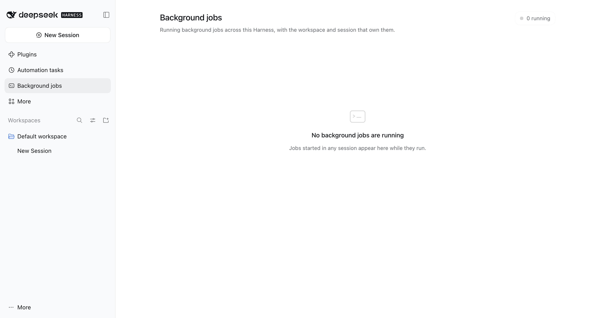

# DSH 0.2.2-rc.1 verification

- Date: 2026-11-06
- status: passed
- Packages: dsh-mosaic 1.1.4 (1.1.5 has identical runtime code), dsh-superpowers 1.0.1, dsh-view-background-jobs 0.1.0
- Commands: `npm test`, `npm run pack:check`, `npm run compat:probe`
- Desktop: passed (2026-11-06)

`status: passed` covers the deterministic checks. The desktop check is recorded separately
on the `Desktop:` line; `compat:record` refuses a record whose status is not `passed`.

Desktop evidence: the app was restarted with the profile links pointing at
`dsh-plugins/packages/...`; the skill catalog loaded `dsh-superpowers` and `dsh-mosaic`, and a
separate `dsh web` UI probe (own `DSH_HOME`) showed the Background jobs panel and the Mosaic
settings section. The Background jobs panel is captured in
`docs/verification/0.2.2-rc.1/background-jobs.jpg`.

